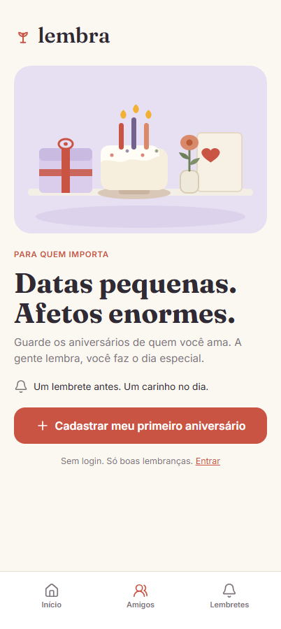
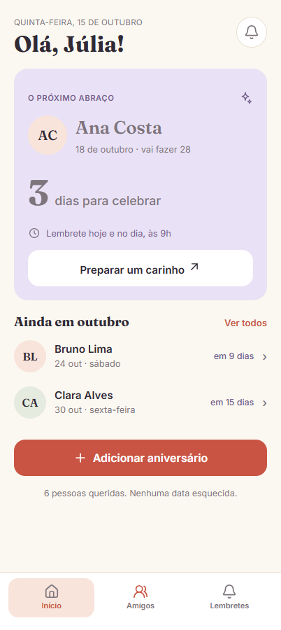
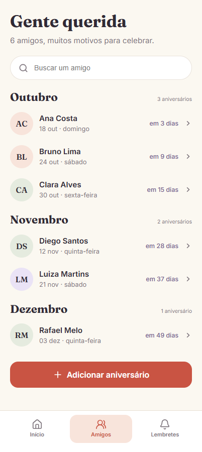
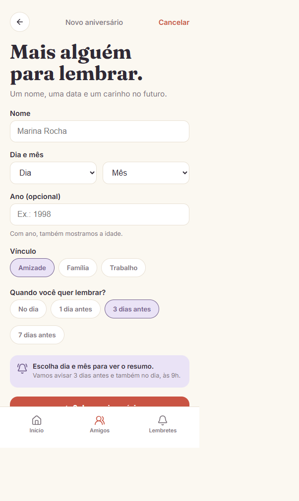
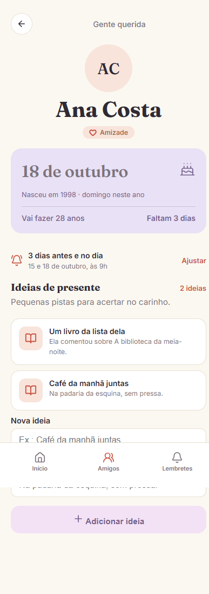
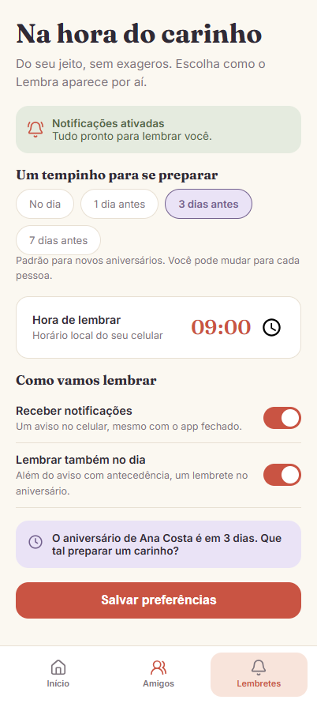

# LembraAI


App de lembretes de aniversários: guarde as datas de quem você ama — o LembraAI lembra, você faz o dia especial. Interface mobile, com conta por e-mail, agenda por mês, ideias de presente e preferências de lembrete.

## Telas

| Boas-vindas | Login | Início |
|---|---|---|
|  |  |  |

| Amigos | Cadastrar | Detalhe | Lembretes |
|---|---|---|---|
|  |  |  |  |

## Funcionalidades

- Conta com e-mail + senha (hash, sessão de 30 dias, sem login social no MVP)
- Início com "o próximo abraço", contagem regressiva e agenda do mês
- Amigos com busca e agrupamento por mês
- Cadastro de aniversário com vínculo, antecedência e resumo automático
- Detalhe com idade, dias restantes e ideias de presente
- Preferências de lembrete (antecedência padrão, hora, toggles) — cálculo e exibição, sem envio real no MVP

## Stack

- **Back-end:** Python + Flask + `sqlite3` da stdlib (sem ORM)
- **Front-end:** Jinja + CSS puro + JS vanilla mínimo
- **Banco:** SQLite em arquivo único (`instance/lembraai.sqlite`)

## Como rodar

```powershell
pip install -r requirements.txt
python -m flask --app app init-db
python -m flask --app app seed-demo
python -m flask --app app run
```

Abra `http://127.0.0.1:5000`. Conta demo: `demo@lembra.ai` / `lembra123`.

## Testes

```powershell
python -m pytest -q
```

## Estrutura

```
app.py                  # factory Flask, rotas, regras de data, seed
schema.sql              # users, birthdays, gift_ideas, preferences
templates/              # 7 telas Jinja + base + auth
static/css/tokens.css   # tokens do Figma (cores, Fraunces + Inter)
static/img/             # ícones e ilustração (assets do Figma, locais)
docs/screenshots/       # prints das telas
tests/test_auth.py      # testes de auth e isolamento por usuário
```

## Licença

MIT — veja [LICENSE](LICENSE).
